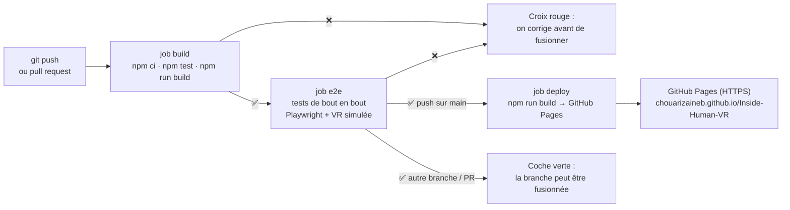

# Intégration et déploiement continus (CI/CD)

**Auteur** : Chouari Zaineb · **Date** : 12 novembre 2026, mise à jour le 28 novembre 2026 (workflow unique) ·
**Rôle** : automatisation des tests et de la mise en ligne

Le projet utilise **GitHub Actions** : un seul fichier de configuration, **`.github/workflows/ci-cd.yml`**, que GitHub
exécute automatiquement sur ses serveurs. Il enchaîne trois jobs : **build → e2e → deploy**.
Le site n'est mis en ligne **que si tous les tests passent** (tests unitaires ET tests de bout en bout en VR simulée).

## 1. Déclencheurs et environnement

| Réglage | Valeur |
|---|---|
| Déclencheurs | `push` sur `main`, `develop` et `feature/**` ; `pull_request` vers `main` et `develop` ; `workflow_dispatch` (bouton *Run workflow* de l'onglet **Actions**) |
| Machine | `runs-on: ubuntu-26.04` pour les trois jobs (version fixe plutôt que `ubuntu-latest`, pour que la machine ne change pas sans qu'on le décide) |
| Node.js | **26.13.1**, version LTS « Lithium » (`actions/setup-node` avec `cache: npm`) ; la même version est indiquée dans `.nvmrc` et dans `package.json` (`"engines": { "node": ">=26.13.1" }`) |
| Actions officielles | `actions/checkout@v7`, `actions/setup-node@v7`, `actions/upload-artifact@v7`, `actions/configure-pages@v6`, `actions/upload-pages-artifact@v5`, `actions/deploy-pages@v5` : dernières versions majeures, qui tournent sur Node 24 (plus d'avertissement « Node.js 20 is deprecated ») |
| Annulation | Un nouveau push sur la même branche annule le passage précédent, sauf sur `main` (on n'interrompt jamais une publication) |

## 2. Job `build` : installation, tests unitaires et build

| Étape | Commande | Ce qui est vérifié |
|---|---|---|
| 1 | `npm ci` | Le projet s'installe avec les versions exactes de `package-lock.json` |
| 2 | `npm test` | Les tests unitaires (`src/scripts/tests/*.test.mjs` : progression, score, tableau de bord) passent |
| 3 | `npm run build` | La version de production se construit sans erreur |

## 3. Job `e2e` : tests de bout en bout (`needs: build`)

| Étape | Commande | Ce qui est vérifié |
|---|---|---|
| 1 | `npm ci` | Installation |
| 2 | `npx playwright install --with-deps chromium` | Le navigateur de test est installé |
| 3 | `npm run test:e2e` (avec `HEADLESS=1`) | Les **13 tests de bout en bout** (`src/scripts/tests/e2e/`) passent : WebGPU, CDN, session `immersive-vr` simulée (Meta Quest 3), gâchette, grip, joystick, mission des poumons, modèles Blender, PWA hors ligne |
| 4 | Envoi du rapport (`if: always()`) | Le rapport Playwright (captures et traces en cas d'échec) est téléchargeable 14 jours depuis l'onglet **Actions** (artefact `rapport-playwright`) |

Sur les serveurs Linux de GitHub, il n'y a pas de carte graphique : WebGPU passe par **SwiftShader**, le rendu logiciel
de Chromium (options dans `playwright.config.mjs`). Le code testé est exactement le même que sur un PC.

## 4. Job `deploy` : mise en ligne (`needs: [build, e2e]`)

**Quand ?** Seulement pour un `push` sur `main` (`if: github.event_name == 'push' && github.ref == 'refs/heads/main'`),
et seulement si `build` ET `e2e` ont réussi.

| Étape | Ce qui se passe |
|---|---|
| 1 | `npm ci`, puis `npm run build` produit le dossier `dist/` |
| 2 | `actions/configure-pages` prépare GitHub Pages |
| 3 | `actions/upload-pages-artifact` envoie `dist/` |
| 4 | `actions/deploy-pages` publie : **https://chouarizaineb.github.io/Inside-Human-VR/** |

Ce job a ses propres droits (`pages: write`, `id-token: write`), l'environnement `github-pages` (l'adresse publiée
s'affiche dans le résumé du passage) et `concurrency: { group: pages, cancel-in-progress: false }` : un seul
déploiement à la fois, et un déploiement commencé n'est jamais interrompu.

**Pourquoi ça fonctionne sans modification du code :**
- `vite.config.mjs` utilise `base: './'` : tous les chemins sont relatifs, donc l'application marche dans le sous-dossier `/Inside-Human-VR/` ;
- `missions.json`, les modèles `.glb` et le décodeur Draco sont chargés avec le chemin de base de Vite (`import.meta.env.BASE_URL`) ;
- le plugin `inside-human-static-files` copie `src/assets/`, `src/sw.mjs` et `src/manifest.webmanifest` tels quels dans `dist/` :
  leurs adresses restent les mêmes qu'avant (`/sw.mjs`, `/manifest.webmanifest`, `/assets/models/*.glb`…) ;
- le Service Worker est enregistré avec une portée relative (`./sw.mjs`, `scope: './'`) ;
- GitHub Pages fournit le **HTTPS**, obligatoire pour WebXR et pour le Service Worker.

## 5. Mise en place (une seule fois)

1. Sur GitHub : **Settings → Pages → Build and deployment → Source : GitHub Actions**.
2. Fusionner `.github/workflows/ci-cd.yml` dans `main`.
3. Onglet **Actions** : le workflow **CI/CD** apparaît et se lance.

## 6. Lire les résultats

- **Onglet Actions** : la liste des passages, avec leur durée et leur résultat. Un clic sur un passage montre les trois jobs, chaque étape et ses messages.
- **Pull request** : en bas, la section *Checks* indique l'état des jobs `build` et `e2e` avant la fusion.
- **Badge** en haut du README : l'état du workflow `ci-cd.yml`.
- **Lien de démo** en haut du README : la dernière version publiée.
