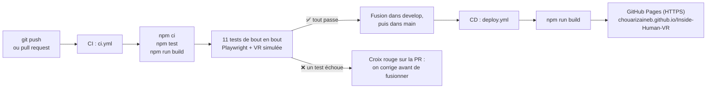

# Intégration et déploiement continus (CI/CD)

**Auteur** : Chouari Zaineb · **Date** : 12 novembre 2026 · **Rôle** : automatisation des tests et de la mise en ligne

Le projet utilise **GitHub Actions** : des fichiers de configuration (`.github/workflows/`) que GitHub exécute
automatiquement sur ses serveurs.

## 1. Intégration continue : `.github/workflows/ci.yml`

**Quand ?** À chaque `push` sur `main`, `develop` ou une branche `feature/...`, et à chaque pull request vers `main` ou `develop`.

| Étape | Commande | Ce qui est vérifié |
|---|---|---|
| 1 | `npm ci` | Le projet s'installe avec les versions exactes de `package-lock.json` |
| 2 | `npm test` | Les tests unitaires de progression (Melek) passent |
| 3 | `npm run build` | La version de production se construit sans erreur |
| 4 | `npx playwright install --with-deps chromium` | Le navigateur de test est installé |
| 5 | `npm run test:e2e` (avec `HEADLESS=1`) | Les **11 tests de bout en bout** passent : WebGPU, session `immersive-vr` simulée (Meta Quest 3), gâchette, grip, joystick, mission des poumons, PWA hors ligne |
| 6 | Envoi du rapport | Le rapport Playwright (captures et traces en cas d'échec) est téléchargeable 14 jours depuis l'onglet **Actions** |

Sur les serveurs Linux de GitHub, il n'y a pas de carte graphique : WebGPU passe par **SwiftShader**, le rendu logiciel
de Chromium (options dans `playwright.config.js`). Le code testé est exactement le même que sur un PC.

**Résultat** : chaque pull request affiche une **coche verte** (tout passe) ou une **croix rouge** (un test échoue), avec le
détail dans l'onglet **Actions**. On ne fusionne une branche que si la coche est verte.

## 2. Déploiement continu : `.github/workflows/deploy.yml`

**Quand ?** À chaque fusion dans `main` (ou manuellement : onglet **Actions** → *Déploiement GitHub Pages* → *Run workflow*).

| Étape | Ce qui se passe |
|---|---|
| 1 | `npm ci`, puis `npm test` : on ne publie jamais une version cassée |
| 2 | `npm run build` produit le dossier `dist/` |
| 3 | `dist/` est envoyé à **GitHub Pages** |
| 4 | L'application est en ligne : **https://chouarizaineb.github.io/Inside-Human-VR/** |

**Pourquoi ça fonctionne sans modification du code :**
- `vite.config.js` utilise `base: './'` : tous les chemins sont relatifs, donc l'application marche dans le sous-dossier `/Inside-Human-VR/` ;
- `levels.json` est chargé avec le chemin de base de Vite (`BaseLevel.js`) ;
- le Service Worker est enregistré avec une portée relative (`./sw.js`, `scope: './'`) ;
- GitHub Pages fournit le **HTTPS**, obligatoire pour WebXR et pour le Service Worker.

Ces points ont été vérifiés en servant `dist/` dans un sous-dossier `/Inside-Human-VR/` : la scène, `levels.json`, le Service
Worker et le démarrage hors ligne fonctionnent, sans aucune erreur 404.

## 3. Mise en place (une seule fois)

1. Sur GitHub : **Settings → Pages → Build and deployment → Source : GitHub Actions**.
2. Fusionner les fichiers `.github/workflows/ci.yml` et `deploy.yml` dans `main`.
3. Onglet **Actions** : les deux workflows apparaissent et se lancent.

## 4. Lire les résultats

- **Onglet Actions** : la liste des passages, avec leur durée et leur résultat. Un clic sur un passage montre chaque étape et ses messages.
- **Pull request** : en bas, la section *Checks* indique l'état du CI avant la fusion.
- **Badge** en haut du README : l'état du CI sur `main`.
- **Lien de démo** en haut du README : la dernière version publiée.
