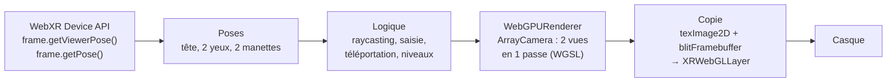

# Pipeline XR : formalisation mathématique du moteur

**Auteur** : Chouari Zaineb · **Date** : 12 novembre 2026 · **Rôle** : moteur, VR et interactions

Ce document formalise les calculs du moteur d'Inside Human VR, de la pose du casque fournie par l'API WebXR Device
jusqu'à l'image affichée, ainsi que les algorithmes d'interaction (raycasting, saisie, téléportation, rotation, zones de dépôt).
Chaque section renvoie au fichier qui implémente la formule.

---

## 0. Vue d'ensemble d'une image en VR



| Étape | Fichier |
|---|---|
| Session, manettes | `src/core/XRManager.js` |
| Poses, rendu stéréo, copie | `src/core/XRPresenter.js` |
| Rendu WebGPU | `src/core/Renderer.js` |
| Raycasting, saisie | `src/systems/Interaction.js` |
| Téléportation | `src/systems/Teleport.js` |
| Rotation sur soi, manipulation | `src/systems/Manipulation.js` |

---

## 1. Repères et conventions

- Repère **direct**, axe $y$ vers le haut, $-z$ = « devant », unités en **mètres**.
- Espace de référence WebXR **`local-floor`** : l'origine est au niveau du sol, sous la position de départ de l'utilisateur.
- Les positions sont en **coordonnées homogènes** $\tilde{p} = (x, y, z, 1)^T$, les directions en $(x, y, z, 0)^T$.
- Une transformation rigide (rotation $R$, translation $t$) s'écrit comme une matrice $4 \times 4$ :

```math
M = \begin{pmatrix} R & t \\ 0 & 1 \end{pmatrix}, \qquad
M^{-1} = \begin{pmatrix} R^T & -R^T t \\ 0 & 1 \end{pmatrix}
```

Comme $R$ est orthogonale ($R^{-1} = R^T$), l'inverse d'une pose est peu coûteux à calculer.

---

## 2. Graphe de scène et matrice monde

Chaque objet a une matrice locale $L$ (relative à son parent). Sa matrice monde est le produit le long de la hiérarchie :

```math
M_{\text{monde}}(o) = M_{\text{monde}}(\text{parent}(o)) \cdot L(o)
```

L'utilisateur est représenté par un groupe **`player`** ($M_P$) qui contient la caméra et les manettes. WebXR donne les poses
**dans le repère `local-floor`**, c'est-à-dire relativement à `player`. Déplacer l'utilisateur (téléportation, rotation sur soi)
revient donc à modifier $M_P$ seulement : la tête et les mains suivent automatiquement.

---

## 3. De la pose WebXR aux matrices de rendu (`XRPresenter._onFrame`)

À chaque image, `frame.getViewerPose(localFloor)` renvoie la pose de la tête $T_H$ et, pour chaque œil $i \in \{G, D\}$,
une transformation $T_{E_i}$ et une matrice de projection $P_i$ (`view.transform.matrix`, `view.projectionMatrix`).

**Tête** (caméra principale, enfant de `player`) :

```math
M_{\text{tête}} = M_P \cdot T_H
```

**Œil $i$** : matrice monde, puis matrice de vue (inverse) :

```math
M_{E_i} = M_P \cdot T_{E_i}, \qquad V_i = M_{E_i}^{-1}
```

**Projection d'un point** $\tilde{p}$ (coordonnées monde) vers l'écran de l'œil $i$ :

```math
\tilde{c}_i = P_i \, V_i \, \tilde{p}
\quad\Longrightarrow\quad
n_i = \left( \frac{c_x}{c_w}, \frac{c_y}{c_w}, \frac{c_z}{c_w} \right) \quad \text{(coordonnées normalisées, NDC)}
```

**Viewport** : `layer.getViewport(view)` donne le rectangle $(x_i, y_i, w_i, h_i)$ de l'œil dans l'image commune
(œil gauche à gauche, œil droit à droite). Le pixel final est :

```math
u = x_i + \frac{n_x + 1}{2} \, w_i, \qquad v = y_i + \frac{n_y + 1}{2} \, h_i
```

**Une seule passe pour les deux yeux** : l'`ArrayCamera` contient les deux sous-caméras $(P_i, V_i, \text{viewport}_i)$.
Le `WebGPURenderer` parcourt la scène une fois et dessine chaque objet visible dans les deux viewports :
le coût de préparation (tri, culling, liaison des ressources) est payé une fois au lieu de deux.

**Élimination hors champ (frustum culling)** : chaque œil a son tronc de vision, défini par les 6 plans tirés des lignes de
$P_i V_i$. Un objet de sphère englobante (centre $c$, rayon $r$) est éliminé pour l'œil $i$ si, pour un des plans
$(\vec{n}_k, d_k)$ :

```math
\vec{n}_k \cdot c + d_k < -r
```

---

## 4. Projection perspective (mode bureau, `Renderer.js`)

Caméra : champ vertical $\varphi = 70°$, rapport $a = L/H$ de la fenêtre, plans proche $n = 0{,}01$ m et lointain $f = 200$ m.
Avec $s = 1 / \tan(\varphi/2)$, la matrice de projection (convention de profondeur $[0, 1]$ de WebGPU) est :

```math
P = \begin{pmatrix}
\frac{s}{a} & 0 & 0 & 0 \\
0 & s & 0 & 0 \\
0 & 0 & \frac{f}{n - f} & \frac{n f}{n - f} \\
0 & 0 & -1 & 0
\end{pmatrix}
```

**Pourquoi $n = 0{,}01$ m ?** L'utilisateur est « miniaturisé » et s'approche très près des organes. Un plan proche plus grand
couperait les objets à quelques centimètres des yeux. Contrepartie : la précision de profondeur varie en $1/z$ ;
avec un rapport $f/n = 2 \cdot 10^4$, elle reste suffisante pour des scènes de quelques mètres.

---

## 5. Copie de l'image vers le casque (`XRPresenter._present`)

Le canvas WebGPU a son origine **en haut**, un framebuffer WebGL **en bas**. Pour une image de hauteur $H$, la ligne $v$
du canvas devient la ligne :

```math
v' = H - 1 - v
```

C'est ce que fait `UNPACK_FLIP_Y_WEBGL` au moment de `texImage2D`, avant le `blitFramebuffer` (copie pixel à pixel,
sans aucun dessin WebGL).

---

## 6. Raycasting : savoir ce que l'utilisateur vise (`Interaction.js`)

### 6.1 Le rayon

Un rayon est une demi-droite :

```math
r(t) = o + t \, \vec{d}, \qquad t \ge 0, \quad \lVert \vec{d} \rVert = 1
```

- **En VR** (manette $k$, matrice monde $M_{C_k}$ donnée par `frame.getPose(targetRaySpace)`, puis multipliée par $M_P$) :

```math
o = M_{C_k} \, (0, 0, 0, 1)^T, \qquad \vec{d} = \frac{M_{C_k} \, (0, 0, -1, 0)^T}{\lVert M_{C_k} \, (0, 0, -1, 0)^T \rVert}
```

- **En mode bureau** (réticule au centre de l'écran, NDC $(0, 0)$) : on « déprojette » deux points de profondeurs différentes :

```math
o = \text{position de la caméra}, \qquad
\vec{d} = \operatorname{normalise}\!\left( M_{\text{cam}} \, P^{-1} (0, 0, 0{,}5, 1)^T - o \right)
```

### 6.2 Test rapide sur la sphère englobante

Avant de tester les triangles, on élimine les objets dont la sphère englobante (centre $c$, rayon $\rho$) n'est pas touchée.
Avec $\vec{w} = o - c$ :

```math
t^2 + 2 (\vec{d} \cdot \vec{w}) \, t + (\lVert \vec{w} \rVert^2 - \rho^2) = 0
\quad\Rightarrow\quad
\Delta = (\vec{d} \cdot \vec{w})^2 - (\lVert \vec{w} \rVert^2 - \rho^2)
```

Si $\Delta < 0$, le rayon manque la sphère, et donc tous les triangles de l'objet.

### 6.3 Intersection rayon-triangle (coordonnées barycentriques)

Pour un triangle $(A, B, C)$, on cherche $t, u, v$ tels que $o + t \vec{d} = (1 - u - v) A + u B + v C$.
Avec $\vec{e}_1 = B - A$, $\vec{e}_2 = C - A$, $\vec{s} = o - A$ :

```math
\vec{h} = \vec{d} \times \vec{e}_2, \quad \det = \vec{e}_1 \cdot \vec{h}, \quad
u = \frac{\vec{s} \cdot \vec{h}}{\det}, \quad
\vec{q} = \vec{s} \times \vec{e}_1, \quad
v = \frac{\vec{d} \cdot \vec{q}}{\det}, \quad
t = \frac{\vec{e}_2 \cdot \vec{q}}{\det}
```

Le triangle est touché si $|\det| > \varepsilon$, $u \ge 0$, $v \ge 0$, $u + v \le 1$ et $t > 0$.
Le **point d'impact** est $o + t \vec{d}$.

Ces formules sont celles de **Möller et Trumbore** (1997), la formulation classique. Three.js r187 (`Ray.intersectTriangle`)
implémente la variante **« étanche »** de **Woop, Benthin et Wald** (2013) : elle calcule les mêmes coordonnées barycentriques
$(u, v)$ et la même distance $t$, mais après un changement de repère qui aligne le rayon sur l'axe $z$. Résultat : un rayon qui
passe exactement sur l'arête commune de deux triangles touche toujours l'un des deux (pas de « trou » numérique entre les triangles).

### 6.4 Objet visé

Parmi tous les objets enregistrés (et leurs enfants), on garde le plus proche :

```math
o^* = \arg\min_{o} \; t_{\min}(o)
```

Le rayon visible de la manette est raccourci à cette distance : sa longueur vaut $t_{\min}$ (ou 5 m si rien n'est touché).

**Coût** : pour $N$ objets de $T_j$ triangles, le test est en $O(N)$ pour les sphères, puis $O(T_j)$ seulement pour les objets
dont la sphère est touchée. Il est fait **une fois par pointeur et par image** (2 manettes en VR, 1 réticule en bureau).

---

## 7. Saisir un objet sans le faire « sauter » (`Interaction._grab`, `_release`)

À la saisie, l'objet change de parent : il passe de son parent $\Pi$ à la main (ou la caméra) $H$. Pour qu'il garde **la même
position dans le monde**, sa nouvelle matrice locale doit vérifier :

```math
M_H \cdot L' = M_{\text{monde}}(o)
\quad\Longrightarrow\quad
L' = M_H^{-1} \, M_{\text{monde}}(o)
```

C'est ce que calcule `holder.attach(objet)`. Ensuite, comme $L'$ est constante, l'objet suit la main : $M_{\text{monde}} = M_H L'$.
Au lâcher, on revient au parent d'origine avec $L = M_\Pi^{-1} \, M_{\text{monde}}(o)$ : l'objet reste exactement où on l'a lâché.

---

## 8. Déplacements

### 8.1 Téléportation avec compensation de la tête (`Teleport._move`)

En VR, la tête n'est pas forcément au centre de `player` (l'utilisateur a pu bouger dans sa pièce). Pour que **la tête**
arrive sur le point visé $q$, on place d'abord `player` sur $q$ avec l'orientation $\theta_q$, puis on corrige le décalage
horizontal de la tête $h$ :

```math
p_P \leftarrow q, \qquad
p_P \leftarrow p_P + \begin{pmatrix} q_x - h_x \\ 0 \\ q_z - h_z \end{pmatrix}
```

La hauteur n'est pas corrigée : elle reste celle de l'utilisateur réel (`local-floor`).

**Fondu au noir** : une sphère noire collée à la caméra a une opacité $\alpha(t)$ sur deux phases de durée $\tau = 0{,}15$ s :

```math
\alpha(t) = \begin{cases} t / \tau & 0 \le t < \tau \quad \text{(le saut a lieu à } t = \tau\text{)} \\ 2 - t / \tau & \tau \le t \le 2\tau \end{cases}
```

### 8.2 Rotation sur soi autour de la tête (`Manipulation.snapTurn`)

Tourner `player` autour de sa propre origine ferait « glisser » la tête. On tourne donc autour de l'axe vertical qui passe
par la tête $h$, d'un angle $\theta = \pm 30°$ :

```math
p_P' = R_y(\theta) \, (p_P - h) + h, \qquad \psi_P' = \psi_P + \theta,
\qquad
R_y(\theta) = \begin{pmatrix} \cos\theta & 0 & \sin\theta \\ 0 & 1 & 0 \\ -\sin\theta & 0 & \cos\theta \end{pmatrix}
```

La position de la tête est ainsi un **point fixe** de la transformation : seul le regard tourne.

---

## 9. Joysticks et vibrations (`Manipulation.js`, `XRManager.js`)

Le joystick donne $(x, y) \in [-1, 1]^2$ (axes 2 et 3 du gamepad `xr-standard`).

**Zone morte** : une entrée est ignorée si $|x| < \delta$, avec $\delta = 0{,}15$ (petits mouvements involontaires).

**Hystérésis du snap turn** : un palier est déclenché quand $|x|$ dépasse $s_{\text{on}} = 0{,}7$, et le suivant n'est possible
qu'après un retour sous $s_{\text{off}} = 0{,}3$. Avec un seul seuil, le bruit autour du seuil déclencherait plusieurs paliers.

**Objet tenu** : avec $\Delta t$ la durée de l'image,

```math
\psi_o \leftarrow \psi_o - x \, \omega \, \Delta t, \qquad
\lVert p_o \rVert \leftarrow \operatorname{clamp}\!\left( \lVert p_o \rVert - y \, v \, \Delta t,\; 0{,}15,\; 3 \right)
```

où $\omega = 2{,}5$ rad/s, $v = 1{,}2$ m/s, et $p_o$ est la position de l'objet dans le repère de la main
(on garde sa direction et on change seulement sa longueur).

**Retour haptique** : `gamepad.hapticActuators[0].pulse(a, d)` avec une intensité $a \in [0, 1]$ et une durée $d$ (ms),
croissantes avec l'importance de l'action : survol $(0{,}15 ; 15)$, sélection $(0{,}6 ; 50)$, saisie $(0{,}8 ; 70)$.

---

## 10. Animations et interpolations

**Pas de temps** (`Engine.step`) : borné pour la stabilité de toutes les animations :

```math
\Delta t_k = \operatorname{clamp}(t_k - t_{k-1},\; 0,\; 0{,}1 \text{ s})
```

La borne basse corrige un premier $\Delta t$ légèrement négatif (horodatage du navigateur antérieur à l'initialisation),
qui faisait sortir l'animation du sang de son intervalle. La borne haute évite un saut énorme après une pause.

**Interpolation linéaire** (positions, couleurs) :

```math
\operatorname{lerp}(a, b, s) = (1 - s) \, a + s \, b, \qquad s \in [0, 1]
```

**Lissage de départ et d'arrivée** (*smoothstep*, déplacement des molécules et retour du cœur) :

```math
s(t) = 3t^2 - 2t^3, \qquad s(0) = 0,\; s(1) = 1,\; s'(0) = s'(1) = 0
```

La vitesse est nulle au départ et à l'arrivée : le mouvement ne « claque » pas.

**Rotation** (retour du cœur à son orientation) : interpolation sphérique de quaternions unitaires, avec
$\cos \Omega = q_0 \cdot q_1$ :

```math
\operatorname{slerp}(q_0, q_1, s) = \frac{\sin((1 - s)\Omega)}{\sin \Omega} \, q_0 + \frac{\sin(s \Omega)}{\sin \Omega} \, q_1
```

Contrairement à une interpolation des angles d'Euler, la vitesse angulaire est constante et il n'y a pas de blocage de cardan.

**Battement du cœur** (`BodyScene`, `XrayBody`) : l'échelle suit $\sigma(t) = 1 + 0{,}05 \, b(t)$, où $b$ est la fonction
de battement de Yessmine (`tissuePulse.js`). Avec la phase $\phi = \operatorname{frac}(t \cdot \text{bpm} / 60)$ et une gaussienne
$g(c, w) = e^{-((\phi - c)/w)^2}$ :

```math
b(t) = g(0{,}08 ;\, 0{,}05) + 0{,}6 \; g(0{,}32 ;\, 0{,}06)
```

Les deux pics reproduisent les deux bruits du cœur : la contraction des ventricules (fort), puis la fermeture des valves (plus faible).

---

## 11. Niveau des poumons : zones de dépôt et couleur du sang (`LungsLevel.js`)

Soit $c$ le centre de l'alvéole, $R_a = 0{,}9$ m son rayon, et $R_c = 1{,}35$ m le rayon de l'arc du capillaire (même centre).
Une molécule lâchée en $p$ est dans :

```math
\text{l'alvéole si } \lVert p - c \rVert < R_a + 0{,}35,
\qquad
\text{le capillaire si } \big| \lVert p - c \rVert - R_c \big| < 0{,}55 \;\text{ et }\; p_x > c_x + 0{,}3
```

Le capillaire est un demi-anneau du côté droit : la condition sur $p_x$ exclut l'autre moitié, et la condition sur la distance
décrit une coque d'épaisseur $2 \times 0{,}55$ m autour de l'arc.

**Couleur du sang** : avec $n_{O_2}$ molécules d'O₂ arrivées sur $N_{O_2} = 3$,

```math
\text{couleur} = \operatorname{lerp}\!\left(\text{bleu},\; \text{rouge},\; \frac{n_{O_2}}{N_{O_2}}\right)
```

**Score** (`GameState`, Melek) : $\text{score} = \max(0,\; 100 - 10 \times \text{erreurs})$.

---

## 12. Performances

| Choix | Effet |
|---|---|
| Deux yeux en **une passe** (`ArrayCamera`) | Préparation de la scène faite une fois pour les deux vues |
| **Instanciation** (`InstancedMesh`, Yessmine) | Des centaines de globules rouges en un seul appel de dessin |
| **Sphère englobante** avant les triangles (§ 6.2) | Raycasting en $O(N)$ pour les objets non visés |
| **Un seul niveau en mémoire** (`LevelManager`) | Géométries et matériaux libérés à chaque changement (`dispose`) |
| **Culling par œil** (§ 3) | Les objets hors champ ne sont pas dessinés |
| $\Delta t$ borné (§ 10) | Animations stables, même après une pause |

Objectif : 72 images/s minimum en VR (cahier des charges, ENF-01). La console affiche le compteur d'images/s en développement.

---

## Références

- W3C, *WebXR Device API* : sessions, espaces de référence, `XRViewerPose`, `XRView`, `XRInputSource`.
- W3C, *WebXR Gamepads Module* : mapping `xr-standard` des boutons et axes.
- W3C, *WebXR/WebGPU Binding* (brouillon) : `XRGPUBinding`.
- T. Möller, B. Trumbore, *Fast, Minimum Storage Ray/Triangle Intersection*, Journal of Graphics Tools, 1997.
- S. Woop, C. Benthin, I. Wald, *Watertight Ray/Triangle Intersection*, Journal of Computer Graphics Techniques, 2013.
- K. Shoemake, *Animating Rotation with Quaternion Curves*, SIGGRAPH 1985 (slerp).
- Documentation Three.js r187 : `WebGPURenderer`, `ArrayCamera`, `Raycaster`, `Object3D.attach`.
