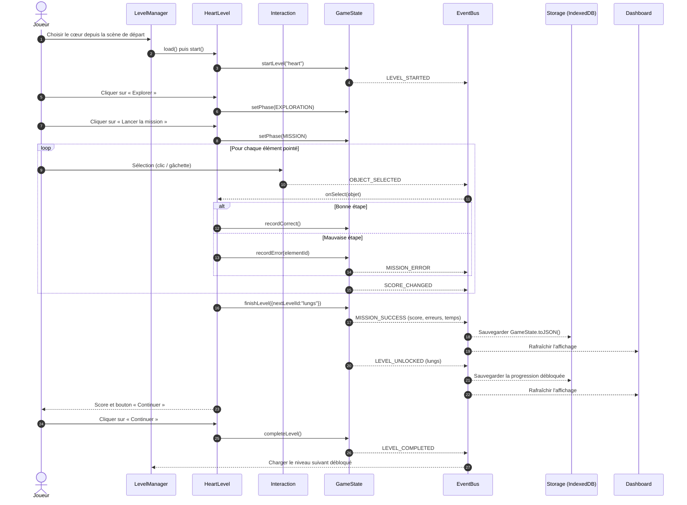
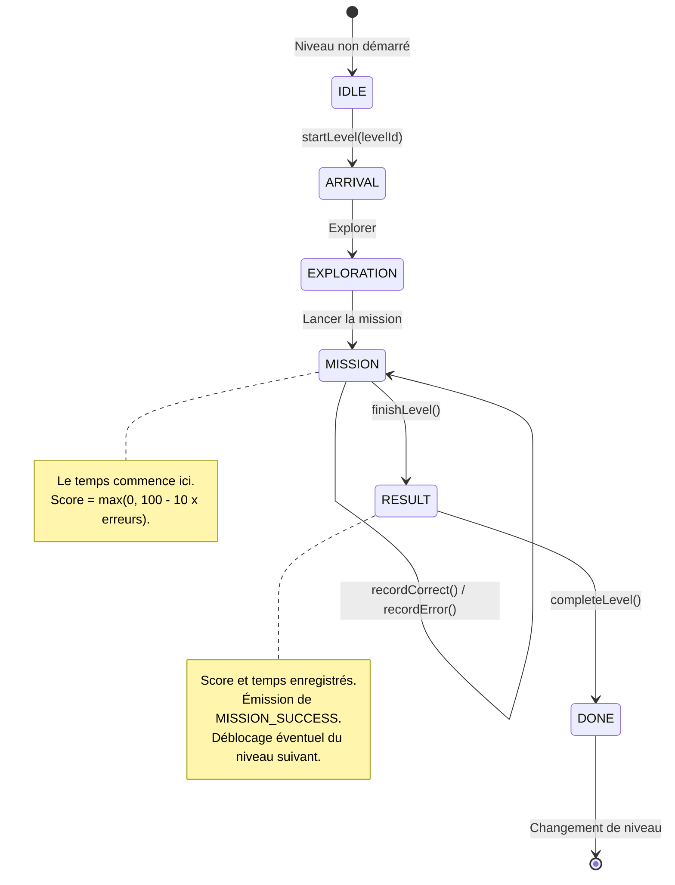

# Inside Human VR — Design Notebook, semaine 3 (Malouli Melek)

Ce document présente les **deux diagrammes demandés** : séquence et états d'un niveau.
Les diagrammes Mermaid sont affichables directement dans GitHub et documentent le code réel.

## 1. Diagramme de séquence — réussite de la mission du cœur

### Comment lire le diagramme

- **Interaction** transforme un clic ou une gâchette en événement `OBJECT_SELECTED`.
- **HeartLevel** vérifie le bon ordre des cavités ; il ne gère pas lui-même IndexedDB.
- **GameState** contrôle les étapes, compte les erreurs et calcule le résultat.
- **EventBus** distribue les événements sans coupler directement les classes.
- **Storage** enregistre les instantanés de progression après une réussite ou un déblocage.
- **Dashboard** affiche ces résultats sur l'écran d'accueil lorsque celui-ci est ouvert.

Le détail des actions peut varier selon le niveau : le cœur utilise une séquence,
les poumons déplacent des molécules, le cerveau suit une séquence de neurones.

## 2. Diagramme d'états — cycle de vie d'un niveau

### Contraintes et invariants

1. Les transitions sont contrôlées par `GameState._transition()` : impossible de passer
   directement de `ARRIVAL` à `MISSION` ou de `MISSION` à `DONE`.
2. La saisie des bonnes/mauvaises réponses est autorisée uniquement pendant `MISSION`.
3. Le compteur de temps commence à l'entrée dans `MISSION`.
4. La réussite stocke `{levelId, score, correct, errors, timeSeconds}` dans
   `GameState.results`, puis l'auto-sauvegarde écrit cet état dans IndexedDB.
5. `LevelManager` charge le niveau suivant après `LEVEL_COMPLETED`.
6. Au démarrage d'un **nouveau** niveau, `GameState.startLevel()` réinitialise la phase à
   `IDLE` avant le passage à `ARRIVAL` ; cela ne constitue pas une transition utilisateur
   directe de `DONE` à `IDLE` au sein d'un même niveau.

## 3. Correspondance avec les fichiers source

| Élément du diagramme | Fichier |
|---|---|
| États, score, résultats et transitions | `src/data/GameState.mjs` |
| Distribution des événements | `src/systems/EventBus.mjs` |
| Logique commune et interactions | `src/levels/BaseLevel.mjs` |
| Mission du cœur | `src/levels/HeartLevel.mjs` |
| Enchaînement des niveaux | `src/core/LevelManager.mjs` |
| Sauvegarde locale | `src/data/Storage.mjs` |
| Agrégation et affichage des résultats | `src/systems/Dashboard.mjs` |

Ces diagrammes peuvent être insérés dans le Design Notebook de l'équipe, ou exportés
en image depuis un outil Mermaid si le professeur demande un fichier image.
